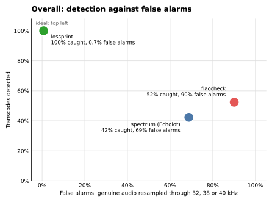
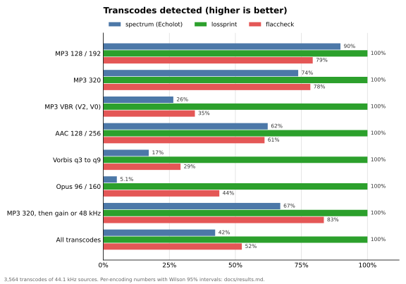
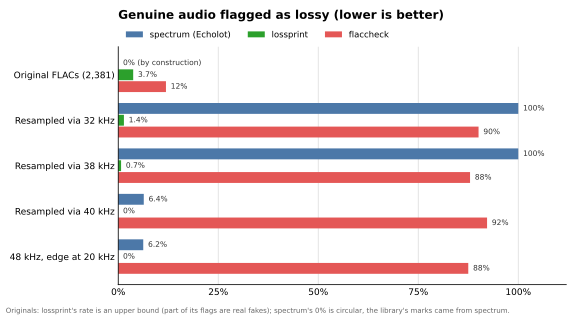
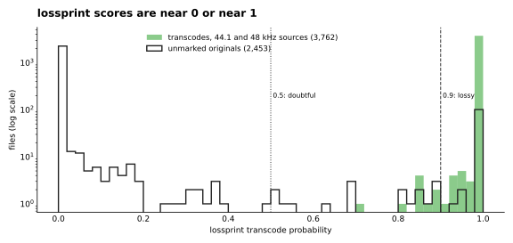
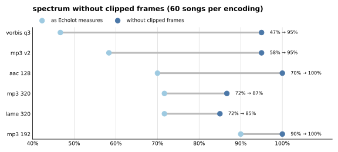

# lossy-bench

Can a FLAC file tell you whether it was made from a lossy file? This repository holds a measured answer for one real
library of 5,092 FLACs. Three lossy-source detectors ran on 2,500 presumed-genuine FLACs and on 4,212 controlled
variants made from them: transcodes, bait and processed files. A 48 kHz control was added. Ground truth comes from
bit-exact captures of Spotify's lossless stream.

Detectors under test:
- the spectrum check of [Echolot](https://github.com/Zweisteinium/echolot), a self-hosted library manager
  (`spectrum()` / `_flicker()` in `src/echolot/library/audio.py`, commit e9f0bf9): looks for an encoder lowpass edge;
- [lossprint](https://crates.io/crates/lossprint) 1.1.0: a CNN on spectrograms;
- flaccheck 0.1.2: a rule and feature fusion.

## Results

**In one sentence: lossprint is the clear winner. It caught all 3,564 transcodes and almost never flagged genuine
audio (0–1.4% of resampled files). Echolot's spectrum check caught 42% and flaccheck 52%, and both flag genuine
audio behind a resampler edge most of the time (69% and 90%).**

| | spectrum | lossprint | flaccheck |
|---|---|---|---|
| **Lossy files detected** (higher is better) | | | |
| MP3 128 / 192 (362 files) | 90% | **100%** | 79% |
| MP3 320 (370) | 74% | **100%** | 78% |
| MP3 VBR: V2, V0 (551) | 26% | **100%** | 35% |
| AAC 128 / 256 (752) | 62% | **100%** | 61% |
| Vorbis q3 to q9 (756) | 17% | **100%** | 29% |
| Opus 96 / 160 (567) | 5.1% | **100%** | 44% |
| MP3 320, then gain or upsampled to 48 kHz (206) | 67% | **100%** | 83% |
| **All transcodes of 44.1 kHz sources (3,564)** | **42%** | **100%** | **52%** |
| Opus 160 at 48 kHz (32) | 6.2% | **100%** | 44% |
| **Genuine audio flagged as lossy** (lower is better) | | | |
| Original FLACs (2,381) | 0%, by construction | 3.7%, upper bound | 12% |
| Genuine, resampled through 32 kHz (141) | 100% | 1.4% | 90% |
| Genuine, resampled through 38 kHz (141) | 100% | 0.7% | 88% |
| Genuine, resampled through 40 kHz (141) | 6.4% | 0% | 92% |
| Genuine 48 kHz with a steep 20 kHz edge (32) | 6.2% | 0% | 88% |

The transcodes come from 18 encoder settings: ffmpeg plus the standalone encoders lame, fdkaac, opusenc and
oggenc. lossprint flags at p ≥ 0.5, flaccheck flags on `TRANSCODED`.

- **spectrum's 0% on the originals proves nothing.** The library's lossy marks came from spectrum itself. The
  unmarked originals are therefore exactly the files spectrum calls clean, and 0 false positives is a consistency
  check, not an estimate. Spectrum's real false-positive evidence is the bait and the 48 kHz control. On the bait it
  flags every genuine file resampled through 32 or 38 kHz.
- **spectrum** misses everything that leaves no edge below ~19.5 kHz: MP3 V0, AAC 256 (ffmpeg), Vorbis q6+ and Opus.
- **lossprint** caught every transcode, including those from the standalone encoders lame, fdkaac, opusenc and
  oggenc. Its lowest score on a transcode was 0.703, and 99.7% scored ≥ 0.9. Its flags on originals are an upper
  bound: many are real fakes, such as Opus rips at 48 kHz carrying a YouTube URL in their tags. Its scores are
  almost never in between, so the exact threshold hardly matters:

  
- **flaccheck** is not usable: it flags ordinary CD-master edges and 90% of the bait.
- **Clipping hides encoder edges.** Decoding a loud lossy file clips, and the distortion fills the empty band above
  the encoder's edge. Measuring spectrum without the clipped frames lifts recall from 72% to 87% on MP3 320, from 58%
  to 95% on MP3 V2 and from 70% to 100% on AAC 128. It adds 1.4% new flags on originals, and 0.4% are not confirmed
  by lossprint.

  
- **Lowering `TRACES_FROM` from 19 to 18 kHz** cuts spectrum's flags on the bait and the 48 kHz control from 64% to
  35% at identical recall. Both held-out halves agree.
- **Lossy masters exist.** Of 10 songs captured bit-exact from Spotify Lossless (9 disputed, 1 control), 8 have
  masters that were themselves made from lossy files; the library copies of 6 of them are bit-identical to the
  stream. A detector's probability cannot tell a lossy copy from a lossy master. Only a capture of the official
  stream can.

From these results follows a combined rule: a spectrum verdict of lossy always stands; otherwise lossprint p ≥ 0.9 is
lossy and 0.5–0.9 doubtful. Echolot uses this rule since 0.12.0.

All numbers with n and Wilson 95% intervals: [docs/results.md](docs/results.md). Other tools (FLAC Detective, fakeflac, auCDtect,
Lossless Audio Checker, Fakin' The Funk and more) and why they were left out: [docs/other-tools.md](docs/other-tools.md).

## Contents

| Path | What |
|---|---|
| [docs/results.md](docs/results.md) | Results in full, the stream-capture ground truth, limitations |
| [docs/methods.md](docs/methods.md) | Detectors, corpus and trust tiers, transcodes, guards, statistics |
| [docs/reproducing.md](docs/reproducing.md) | Re-analysis from the published data; re-measurement on another library |
| [docs/data.md](docs/data.md) | Data dictionary of every file in `corpus/` and `results/`, with checksums |
| `docs/figures/` | The charts, made by `scripts/figures.py` from the analysis output |
| [docs/other-tools.md](docs/other-tools.md) | Other detection tools and research, why they were not benchmarked, a short test of FLAC Detective |
| [TOOLS.md](TOOLS.md) | Setup, invocation and output formats of lossprint and flaccheck |
| [report/](report/) | Groundwork for a written report |
| `scripts/` | Measurement, analysis, experiments and independent verification (`scripts/verify/`) |
| `corpus/` | The sets with tiers and strata, job lists, integrity evidence |
| `results/` | Raw output (one JSON line per job, variant and detector) and the analysis tables |

The audio is not included, for copyright reasons. Everything else needed to re-run the analysis is: `scripts/analyze.py`
rebuilds `results/analysis/` from the raw output byte for byte.
